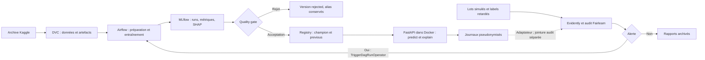

# Scoring de crédit explicable et équité mesurée

Projet pédagogique Home Credit Default Risk : versionner les données, comparer
les modèles, mesurer leurs biais, appliquer un quality gate avant promotion,
servir des explications SHAP et déclencher un réentraînement sur alerte.

**DVC → MLflow → Airflow → Docker → FastAPI → Evidently.**
Fairlearn audite et compare les mitigations ; Pandera contrôle les données.
La boucle v1 accepté → drift → v2 discriminatoire rejeté → v3 mitigé accepté
et API rechargée est exécutée sur un scénario synthétique séparé.

**État vérifié le 3 octobre 2026 : 139 tests passent, builds Docker réussis,
démonstration Airflow complète vérifiée. Aucun champion Home Credit accepté.**
Un candidat repondéré par âge passe le gate de validation avec une AUC de 0,74113,
mais échoue à l'équité par âge sur le test indépendant : AUC 0,74618, DI 0,79692,
écart d'égalité des chances 0,25758. Il est enregistré comme rejeté, sans promotion.
Les résultats synthétiques ne qualifient pas un usage réel de crédit.

[Bilan de livraison et vérifications finales](docs/final-validation.md) :
démonstration complète rejouée, services vérifiés et limite de qualification
Home Credit explicitement conservée.

Une [étude Fairlearn à coûts métier](docs/constrained-development.md) examine
quatre entraînements contraints et huit scores déterministes sur le développement.
Le point respectant l'équité atteint une AUC de 0,73665, sous le minimum de 0,74.
Aucun point ne passe toutes les règles ; le test du protocole v2 reste fermé.

L'[étude de capacité Fairlearn](docs/constrained-capacity-development.md) ultérieure
trouve un ensemble déterministe passant le screening de développement : AUC
0,74725, DI âge 0,80968, EO âge 0,09605. L'instantané est figé et vérifié après
rechargement. **Il n'est pas qualifié ni promu** : SHAP d'ensemble et évaluation
indépendante restent à réaliser selon un plan figé ; le test v2 reste fermé.

## Architecture



La surveillance Home Credit utilise actuellement un candidat figé de diagnostic.
L'adaptateur des logs API est testé ; le DAG courant consomme les lots simulés.
La promotion Home Credit et le rechargement API restent des opérations distinctes.
Les DAGs de démonstration réalisent automatiquement les deux.
[Détails d'architecture](docs/architecture.md).

## Installation

Prérequis : Git, Python **3.11.9 ou plus récent dans la série 3.11**, Docker
avec conteneurs Linux et Docker Compose. Python 3.10 est autorisé par les scripts,
mais l'environnement et la CI de ce dépôt sont vérifiés avec Python 3.11.9.
GNU Make est fourni dans `creditS` par `gnumake` sous Windows ; utiliser GNU Make
système sous Linux/macOS. Airflow s'installe exclusivement dans ses images Docker.

Création initiale Windows, seule exception au venv pour son bootstrap :

```powershell
py -3.11 -m venv creditS
.\creditS\Scripts\Activate.ps1
python -c "import sys; print(sys.prefix)"
python -m pip install gnumake==4.4.1
make setup
```

Si `creditS` existe déjà, commencer directement par son activation.
Le Makefile peut aussi le créer avec le runtime local ignoré `.runtime/python311/tools/`
s'il existe. Les dépendances locales sont épinglées dans `requirements.txt` ;
les images utilisent leurs propres requirements et locks. `creditS/` est exclu
de Git et des images Docker. Aucun paquet global n'est nécessaire.

Création initiale Linux/macOS :

```bash
python3.11 -m venv creditS
source creditS/bin/activate
make setup
```

Sous Linux/macOS, remplacer `runtime.python` dans `params.yaml` par
`creditS/bin/python` et les deux entrées de `.pre-commit-config.yaml` par
`creditS/bin/python scripts/dev.py ...`. Les hooks Windows sont conservés
pour l'environnement vérifié ici.

## Quickstart Windows

Conserver l'archive Kaggle `.zip` à la racine ; son nom est détecté.
Elle contient les neuf tables attendues, dont `HomeCredit_columns_description.csv`.
Le remote DVC local doit être accessible pour une restauration.

```powershell
.\creditS\Scripts\Activate.ps1
python -m dvc pull
make up
docker compose up -d
docker compose ps
curl.exe -i http://localhost:8000/live
curl.exe -i http://localhost:8000/health
make test
make demo
```

`make up` génère les entrées manquantes de `.env`, construit les images et attend
les healthchecks ; `docker compose up -d` peut ensuite relancer la stack.
Les secrets générés restent privés. `/live` répond 200 ; `/health` et le scoring
principal répondent 503 tant qu'aucun champion n'est qualifié. Les cinq services
peuvent donc être healthy sans modèle prêt au scoring.

| Service | Accès par défaut |
| --- | --- |
| API FastAPI | http://localhost:8000/docs |
| MLflow Docker | http://localhost:5001 |
| Airflow | http://localhost:8081 |
| MLflow local, démarré par `make mlflow` | http://localhost:5000 |

Les identifiants Airflow sont dans `.env`. Les deux serveurs MLflow ont des bases
indépendantes ; Docker reçoit une copie initiale de la base locale si elle existe.
DVC restaure les fichiers, **pas** les bases MLflow ni leurs runs.
Le remote résolu ici est le dossier frère `../dvc-storage` ; `../../dvc-storage`
dans `.dvc/config` est relatif au dossier `.dvc`. Pour changer de remote,
utiliser `python -m dvc remote modify storage url <chemin>` après activation.
Sans remote, `make data` extrait et valide l'archive présente.

## Entraînement et gate

```powershell
.\creditS\Scripts\Activate.ps1
make data
make mlflow
make train
make promote
make monitor
```

Sur une nouvelle base MLflow, les sorties restaurées de DVC peuvent référencer
d'anciens runs absents. Après démarrage du serveur local, utiliser
`python -m dvc repro --force` pour recréer des runs et leurs preuves ; cela
réentraîne toutes les étapes. Les modèles précédents ne sont pas automatiquement
qualifiés par une restauration de fichiers.

`sample_frac=0.1` garde le développement rapide ; `1.0` est réservé à une nouvelle
campagne finale. La réserve de production est isolée avant le split stratifié
60/20/20 du reste de `application_train.csv`. Effectifs mesurés : train 14 760,
validation 4 920, test 4 920, production 6 151. `application_test.csv` n'a pas
de cible et ne sert pas à l'évaluation supervisée.

Les encodeurs et imputations sont ajustés sur le train. Les ratios et agrégations
historiques produisent 261 colonnes ordonnées ; les échéances sont regroupées
et l'historique limité au jour de demande. Genre, âge et `EMPLOYED_AGE_RATIO`
restent réservés à l'audit. `TARGET=1` et une décision positive signifient défaut
et refus ; l'acceptation vaut `1 − prédiction`.

Le gate exige AUC ≥ 0,74, baisse ≤ 0,005 face au champion sur les mêmes données
de validation, DI acceptation ≥ 0,8 et écart d'égalité des chances ≤ 0,10 pour
genre et âge. Il vérifie les supports, le recall ≥ 0,50, le taux d'acceptation
entre 0,10 et 0,95, les artefacts SHAP et une inférence déterministe sans attribut
sensible. Un rejet enregistre la version et ses règles échouées, sans déplacer
`champion`. Une acceptation place l'ancien champion sous `previous`.

## Résultats Home Credit

Résultats historiques sur validation, échantillon de développement à 10 %.
Le candidat de la campagne étendue à 20 % a depuis été évalué une seule fois
sur test ; [résultats et rejet](docs/qualification.md).
Les seuils minimisent un coût configurable (défaut manqué : 10, faux refus : 1),
avec contraintes supplémentaires lors de la mitigation.

| Modèle | ROC-AUC | PR-AUC | Seuil de refus |
| --- | ---: | ---: | ---: |
| Régression logistique | 0,7210 | 0,1984 | 0,09 |
| Random Forest | 0,7240 | 0,2339 | 0,09 |
| XGBoost | 0,7372 | 0,2284 | 0,07 |
| LightGBM | 0,7487 | 0,2427 | 0,49 |
| LightGBM reweighing 1,5 | 0,7311 | 0,2276 | 0,55 |

| Audit | Baseline | Reweighing 1,5 |
| --- | ---: | ---: |
| DI genre / âge | 0,8901 / 0,5996 | 0,9871 / 0,8142 |
| Écart TPR genre / âge | 0,0722 / 0,1974 | 0,0150 / 0,0921 |
| Recall défaut | 0,6146 | 0,5214 |
| Gate | Rejet équité âge | Rejet AUC minimale |


Figure issue des résultats MLflow/DVC de mitigation. Le point bleu respecte les
règles de l'étude de mitigation ; **il ne passe pas le gate de promotion**.
La ligne horizontale montre la perte maximale de deux points d'AUC de cette étude,
pas le minimum 0,74 du gate. La ligne verticale marque l'écart TPR 0,10.
Les scores de la mixture ExponentiatedGradient ne représentent pas la même
quantité que le score de risque des arbres. Détails, métriques par groupe,
proxys et limites : [Model Card](docs/MODEL_CARD.md).

## API, monitoring et démonstration

L'API expose `/predict`, `/explain`, `/model-info`, `/health`, `/live` et un
rechargement protégé `/model/reload`. Les champs inconnus et les attributs d'audit
sont rejetés à 422. Les features manquantes sont explicites ; les performances
offline ne qualifient pas automatiquement ce contrat partiel.
[Contrat API](docs/api.md).

Les lots 01–03 restent sans alerte ; 04–05 dérivent financièrement, 06 change
de population, 07 dégrade un groupe et 08 simule une dérive conceptuelle.
Les labels arrivent après deux lots. Une alerte déclenche le DAG d'entraînement
et son gate. Le lot 02 garde son avertissement d'AUC brute sous 0,70 ; l'alerte
utilise par défaut la borne supérieure d'un bootstrap à 95 %.
[Règles et résultats de monitoring](docs/monitoring.md).

`make demo` crée un modèle `credit-demo-<id>` et une API temporaire : v1 accepté
(AUC 0,7548), v2 meilleur mais rejeté pour équité (0,9353), v3 repondéré accepté
(0,9583), aliases `champion=3`, `previous=1`, API rechargée. Le modèle Home Credit
reste inchangé. [Scénario et limites synthétiques](docs/demo.md).

## Vérification et limites

```powershell
.\creditS\Scripts\Activate.ps1
make test
make lint
python -m ruff format --check .
make down
```

La CI GitHub Actions crée `.ci-venv`, installe `requirements.txt`, exécute Ruff
et pytest avec fixtures générées, puis construit API et Airflow sans Kaggle.
Aucun remote Git n'est configuré ici : la CI distante reste à exécuter.
`make down` conserve les volumes et les bases.

Ce dépôt ne fournit pas de PD calibrées, de validation temporelle indépendante,
de qualification bancaire ni de certification réglementaire. Les proxys persistent
malgré l'exclusion des attributs sensibles ; les petits groupes et la sélection
sur validation limitent l'interprétation. Le réentraînement Home Credit repart
du snapshot de données configuré ; l'intégration automatique de nouveaux labels
de production dans un dataset d'entraînement n'est pas implémentée.

[Architecture](docs/architecture.md), [Docker](docs/docker.md),
[Airflow](docs/airflow.md), [Model Card](docs/MODEL_CARD.md).
[Ensemble figé : SHAP et qualification](docs/ensemble-qualification.md) : preuves
SHAP exécutées, plan figé, promotion bloquée jusqu'au test indépendant v2.
[Recherche complémentaire de qualification](docs/qualification.md) : 18 essais,
aucun candidat franchissant simultanément les seuils d'AUC et d'équité.
Une campagne supplémentaire à 20 % des données conserve les réserves existantes ;
ses six essais ne fournissent pas davantage de champion qualifiable.
Neuf essais de neutralisation de proxys ne franchissent pas non plus le gate ;
les profils, résultats et limites sont consignés dans la même documentation.
La repondération par âge franchit la validation, mais échoue sur le test indépendant.
Le gate prend désormais cet échec en compte avant toute promotion de ce candidat.
[Nouveau protocole prospectif](docs/protocol-v2.md) : affectations figées sur
92 253 autres clients, six essais préspécifiés exécutés. Aucun candidat admissible
sur validation ; le nouveau test reste fermé, sans ajout adaptatif ni promotion.
Les preuves historiques sont dans `docs/phase*-validation.md` ;
[phase 11](docs/phase11-validation.md) et [phase 12](docs/phase12-validation.md)
décrivent les validations de ces phases ; le [bilan final](docs/final-validation.md)
consigne la vérification de livraison.
