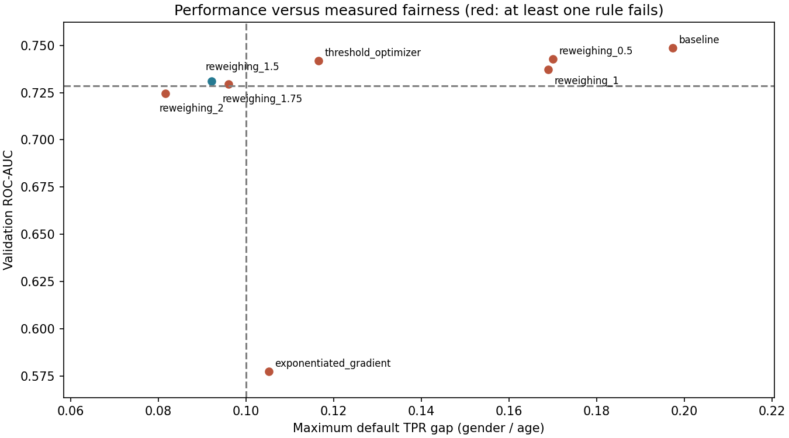

# Model Card — Home Credit et état de qualification

Date de revue : **3 octobre 2026**. Usage prévu : apprentissage MLOps, analyse
offline du risque, explicabilité et audit d'équité. Responsable opérationnel,
population bancaire cible et procédure de recours ne sont pas définis : ce dépôt
n'est pas autorisé à prendre des décisions réelles d'octroi ou de refus de crédit.

**Statut : aucun champion Home Credit accepté.** Le Registry local contient
les versions 1–3 rejetées ; le Registry Docker contient les versions 1–5 rejetées.
La version locale 3 passe le gate de validation mais échoue à l'équité par âge
sur test indépendant. Elle n'est pas promue et n'est pas transférée au Registry Docker.
Les modèles `credit-demo-*` acceptés appartiennent exclusivement à la démonstration
synthétique. Le biais est mesuré et contrôlé selon les métriques décrites sur les
échantillons évalués ; aucune garantie générale d'absence de discrimination n'est donnée.

## Données, version et préparation

Source : Home Credit Default Risk, archive Kaggle conservée à la racine,
extraite de manière idempotente. Tables : application_train, application_test,
bureau, bureau_balance, previous_application, POS_CASH_balance, credit_card_balance,
installments_payments, HomeCredit_columns_description. Les agrégations du modèle
utilisent bureau, previous_application et installments_payments ; toutes les
sources extraites ne sont donc pas actuellement exploitées comme features.

Version brute DVC : **`6d6f2659068bf71e19aece18bd8736eb.dir`** ; descriptor
`data/raw.dvc`. Remote local résolu : dossier frère `../dvc-storage`.
Les paramètres, hashes des inputs et snapshot du lock avant entraînement sont
archivés dans MLflow. Le hash du lock est celui d'un snapshot, pas une promesse
que le lock n'a jamais changé après le run. Les bases MLflow ne sont pas des
artefacts restaurés par DVC.

`TARGET=1` signifie défaut. `application_test.csv` n'a pas de TARGET et ne sert
ni au train ni à la validation ni au test supervisé. Le développement utilise
`sample_frac=0.1`, seed 42 : 30 751 dossiers, puis réserve de production isolée
6 151 et split stratifié 60/20/20 du reste. Train 14 760, validation 4 920,
test réservé 4 920 ; prévalence validation 397/4 920, soit 8,07 %.
Les expériences publiées ne portent pas sur un entraînement final à 100 %.

Les encodeurs, imputations, standardisations et poids de reweighing sont ajustés
sur le train. Les agrégations historiques respectent un cutoff au jour de demande.
`DAYS_EMPLOYED=365243` devient NaN avec indicateur `EMPLOYED_ANOMALY`.
Les ratios de crédit, revenu, annuité, durée et scores externes, ainsi que
14 agrégats historiques, donnent 261 colonnes ordonnées.

Les identifiants ne sont pas des entrées du modèle. `CODE_GENDER`, `DAYS_BIRTH`,
`AGE_YEARS`, `AGE_GROUP` et `EMPLOYED_AGE_RATIO` sont exclus. Âge calculé par
`-DAYS_BIRTH/365.25`, groupes `<30`, `[30,45)`, `[45,60)`, `60+`.
Le ratio emploi/âge est calculé et conservé pour l'audit uniquement, conformément
au choix utilisateur. Les attributs sensibles servent à mesurer l'équité et à
l'étude des mitigations, pas à l'inférence du candidat retenu.

## Modèle, décision et performance globale

Le meilleur modèle de ranking est LightGBM 4.6.0 : 150 arbres, learning rate 0,05,
15 feuilles, minimum 100 observations par feuille, L2=5 et class_weight=balanced.
Le candidat mitigé réutilise cette famille avec des poids de reweighing puissance
1,5 estimés sur les intersections genre/âge et label du train.
La sélection des modèles, hyperparamètres, seuils et mitigations utilise la
validation ; ses métriques peuvent donc être optimistes. Ces résultats décrivent
l'étude historique à 10 %. Un candidat figé de la campagne étendue à 20 % a
ensuite été évalué une seule fois sur test, avec les résultats ci-dessous.

### Candidat figé de la campagne étendue — rejet indépendant

Run `1cdba5300ddc4326aed25e76d99a36b9`, version locale 3 : LightGBM,
300 arbres, 15 feuilles, learning rate 0,03, min_child_samples=100, L2=10,
class_weight=balanced. Repondération calculée uniquement sur les groupes d'âge
et TARGET du train, puissance 1,6. Contrat de 264 features, attributs sensibles
exclus, seuil global **0,587**, aucun attribut sensible requis à l'inférence.
Les 29 520 dossiers train, 9 840 validation et 9 840 test sont disjoints.

| Métrique | Validation | Test indépendant |
|---|---:|---:|
| AUC | 0,74113 | 0,74618 |
| Recall du défaut | 0,50378 | 0,53023 |
| Acceptation | 0,80559 | 0,79970 |
| DI genre | 0,95764 | 0,94729 |
| Écart EO genre | 0,02397 | 0,00476 |
| DI âge | 0,81943 | **0,79692 : échec** |
| Écart EO âge | 0,09464 | **0,25758 : échec** |

Sur test, le TPR du refus est de 0,65341 pour les moins de 30 ans,
0,54054 pour 30–45, 0,43500 pour 45–60 et 0,39583 pour 60+.
Le groupe 60+ contient 1 077 dossiers dont 48 défauts ; le groupe <30 en
contient 1 452 dont 176 défauts. Les supports satisfont le gate, mais les
métriques restent sensibles à l'échantillonnage. Les résultats montrent que
le respect des seuils sur validation ne se généralise pas ici à l'échantillon
indépendant. **Le candidat est rejeté.**

Les six artefacts SHAP sont présents ; l'erreur maximale de reconstruction
des probabilités est de 9,99×10⁻¹⁶. Cela ne corrige pas l'échec d'équité.
La promotion vérifie également le rapport indépendant quand il existe,
recalcule les règles et refuse ce candidat même si la validation est réussie.
Le test ayant été consulté, il ne pourra pas servir à régler de nouveaux
candidats ou seuils en conservant un statut d'évaluation indépendante.
[Protocole, provenance DVC et rapports](qualification.md).
Un [nouveau protocole prospectif](protocol-v2.md) exclut tous les clients de
ces campagnes et fige les nouvelles affectations avant entraînement. Il est
exécuté sur 92 253 clients avec un contrat de 263 features : les six essais
dépassent 0,74 d'AUC validation mais échouent sur l'écart EO âge (0,17183 à
0,23712). Aucun candidat sélectionné, aucun score de ce nouveau test calculé,
aucun champion qualifié. Les résultats ci-dessus concernent exclusivement
le candidat historique étendu, distinct de ce protocole prospectif.

Une [étude de développement ultérieure à coûts métier](constrained-development.md)
réutilise le train et la validation v2, sans ouvrir son test. Quatre réductions
Fairlearn et huit scores déterministes sont mesurés. EqualizedOdds sur
l'intersection genre–âge, avec moyenne des probabilités et seuil global 0,492,
respecte DI/EO et utilité sur validation : DI âge 0,94501, EO âge 0,05894,
DI genre 0,97053, EO genre 0,03238, recall 0,58186. Son AUC 0,73665 échoue au
minimum de 0,74 ; aucun point n'est qualifié. Ces scores déterministes ne
bénéficient pas des garanties de la politique aléatoire originale, ne sont pas
calibrés, et ne sont ni expliqués par SHAP ici ni enregistrés ou promus.

Les paragraphes et tableaux suivants conservent les résultats historiques
de l'étude à 10 %, distincts de ce candidat étendu.

Les scores sont des sorties de ranking **non calibrées**, particulièrement avec
pondération des classes ; le champ API `default_score` ne constitue pas une PD
bancaire. Une prédiction de défaut vaut 1 et signifie refus dans cette convention.
L'acceptation vaut `1 − prédiction`. Les seuils globaux sont 0,49 pour la baseline
et 0,55 pour le candidat repondéré. Le coût de sélection est configurable :
faux négatif (défaut manqué) 10, faux positif (refus à tort) 1.

| Métrique de validation | Baseline | Reweighing 1,5 |
| --- | ---: | ---: |
| ROC-AUC | 0,7487 | 0,7311 |
| PR-AUC | 0,2427 | 0,2276 |
| KS | 0,3770 | 0,3602 |
| Gini | 0,4973 | 0,4623 |
| Recall défaut / TPR | 0,6146 | 0,5214 |
| Précision des refus | 0,1795 | 0,2027 |
| Taux d'acceptation | 0,7238 | 0,7925 |
| Coût sur 4 920 observations | 2 645 | 2 714 |
| Faux négatifs / faux positifs | 153 / 1 115 | 190 / 814 |

La mitigation perd 0,0175 d'AUC, sous la limite de deux points de l'étude ;
les faux négatifs augmentent. Elle ne passe pas le minimum AUC 0,74 du gate.
Le coût choisi et les métriques ne définissent pas à eux seuls un bénéfice
économique ou un niveau de risque acceptable pour une banque.

## Performance et décisions par groupe

Validation seulement. Chaque cellule `baseline / mitigation` utilise les mêmes
observations ; les TPR/FPR portent sur le refus. Les effectifs rendent visible
l'incertitude, en particulier les 26 défauts chez les 60+.

| Groupe | Dossiers | Défauts | AUC baseline / mitigation | Acceptation baseline / mitigation |
| --- | ---: | ---: | ---: | ---: |
| F | 3 244 | 231 | 0,7462 / 0,7242 | 0,7518 / 0,7959 |
| M | 1 675 | 166 | 0,7466 / 0,7410 | 0,6693 / 0,7857 |
| XNA | 1 | 0 | Non estimable | 1,0000 / 1,0000 |
| <30 | 715 | 76 | 0,6936 / 0,6952 | 0,5119 / 0,6755 |
| 30–45 | 2 019 | 200 | 0,7507 / 0,7391 | 0,7023 / 0,8029 |
| 45–60 | 1 646 | 95 | 0,7489 / 0,7335 | 0,7995 / 0,8183 |
| 60+ | 540 | 26 | 0,7160 / 0,7151 | 0,8537 / 0,8296 |

| Groupe | TPR baseline / mitigation | FPR baseline / mitigation |
| --- | ---: | ---: |
| F | 0,5844 / 0,5152 | 0,2224 / 0,1802 |
| M | 0,6566 / 0,5301 | 0,2949 / 0,1796 |
| XNA | Non estimable | 0,0000 / 0,0000 ; un seul dossier |
| <30 | 0,6974 / 0,5921 | 0,4632 / 0,2926 |
| 30–45 | 0,6250 / 0,5000 | 0,2617 / 0,1638 |
| 45–60 | 0,5579 / 0,5158 | 0,1786 / 0,1612 |
| 60+ | 0,5000 / 0,5000 | 0,1284 / 0,1537 |

## Équité, support et promotion

Fairlearn 0.13.0 `MetricFrame` mesure les taux par groupe. DI = taux minimum
sur taux maximum d'acceptation. Demographic parity difference = écart maximal
d'acceptation. Equal opportunity difference = écart maximal du TPR de refus
parmi les défauts réels. Equalized odds difference = maximum des écarts TPR/FPR.
Ces notions mesurent des propriétés distinctes ; l'EO de refus n'est pas définie
ici sur l'acceptation de personnes qui ne font pas défaut.

| Mesure | Baseline genre / âge | Mitigation genre / âge |
| --- | ---: | ---: |
| Disparate impact acceptation | 0,8901 / 0,5996 | 0,9871 / 0,8142 |
| Demographic parity difference | 0,0826 / 0,3418 | 0,0103 / 0,1541 |
| Equal opportunity difference | 0,0722 / 0,1974 | 0,0150 / 0,0921 |
| Equalized odds difference | 0,0725 / 0,3348 | 0,0150 / 0,1389 |

Le gate contrôle DI ≥ 0,8 et EO ≤ 0,10 pour F/M et les quatre groupes d'âge,
avec au moins 100 dossiers et 20 exemples de chaque classe par groupe.
Il ne contraint pas directement demographic parity difference ni equalized odds
par un seuil supplémentaire ; les deux restent rapportées. XNA est affiché mais
exclu de la comparaison faute de support : aucune certification de son équité.
Couverture de la comparaison genre : 4 919/4 920.

Le gate exige aussi AUC ≥ 0,74, baisse d'AUC ≤ 0,005 face au champion sur les
mêmes hashes de validation, recall ≥ 0,50, acceptation entre 0,10 et 0,95,
preuves SHAP et inférence déterministe sans attribut sensible. La baseline
échoue aux deux règles d'équité âge ; la mitigation échoue à l'AUC minimale.
Les versions rejetées restent inspectables avec leurs règles échouées.
Les franchissements proches des limites ne démontrent pas une stabilité hors
échantillon, temporelle, intersectionnelle ou sur d'autres attributs protégés.

Le bleu représente le succès de l'étude de mitigation, pas du gate global.
La ligne horizontale est la limite de perte d'AUC de l'étude (baseline − 0,02).
Le minimum de promotion 0,74 est distinct. Source : comparaisons DVC/MLflow
`reports/fairness/mitigation_comparison.csv` ; aucune mesure n'est fabriquée.

## Explicabilité et proxys

SHAP 0.49.1 TreeExplainer explique la sortie brute LightGBM en log-odds du défaut.
Une contribution positive augmente le score de défaut. Summary, bar et trois
waterfalls (accepté, refusé, limite) sont archivés par run. Le candidat présente
une erreur maximale de reconstruction de probabilité de 4,44e-16, sous 1e-6.
Les trois raisons API utilisent un dictionnaire de libellés français.

Les explications décrivent des associations du modèle, pas des causes ni une
preuve d'équité. Elles portent sur les features transformées et imputées :
une valeur manquante imputée ne doit pas être présentée comme déclarée par le client.
Les proxys peuvent persister malgré l'exclusion des attributs sensibles : un
classifieur auxiliaire prédit le genre connu avec AUC validation 0,8734.
Coefficients et corrélations de l'analyse train sont dans `proxy_report.json`.
Cette analyse ne démontre pas qu'une feature particulière cause une discrimination.

## Limites des comparateurs de mitigation

ThresholdOptimizer est calibré sur une réserve du train, séparée du fit de
l'estimateur. Ses seuils dépendent des intersections genre/âge à l'inférence et
ses décisions sont randomisées ; les groupes insuffisants utilisent un secours
au seuil global. Le comparateur mesuré présente EO âge 0,1166, au-dessus de 0,10.
Il n'est pas retenu et échoue à la règle d'inférence sans attribut sensible.
L'emploi de seuils par groupe dans une décision de crédit soulève une **limite
juridique potentielle**, à examiner selon le contexte et la juridiction ; un
meilleur indicateur d'équité ne rend pas cette pratique automatiquement admissible.
Voir la [documentation Fairlearn 0.13](https://fairlearn.org/v0.13/user_guide/mitigation/postprocessing.html).

ExponentiatedGradient apprend une mixture sous contrainte EqualizedOdds. Son
score est une probabilité de refus de la mixture, pas une PD calibrée ; son AUC
ne décrit pas exactement la même quantité que celle du score de base. Les
comparateurs sont évalués sur leurs décisions tirées avec seed 42. Dans cette
exécution, la mixture accepte 98,35 % et ne rappelle que 7,56 % des défauts :
elle échoue aux règles d'utilité et n'est pas retenue.

## API, monitoring et réentraînement

L'API charge uniquement un champion accepté et vérifie les preuves Registry,
le seuil et les colonnes. Son contrat accepte un sous-ensemble raisonnable des
variables et des agrégats déjà calculés en amont. Les champs sensibles sont
rejetés. L'inférence expose les inputs manquants et conserve le schéma complet,
mais les métriques offline ne qualifient pas ce mode d'entrée partielle.
Sans champion Home Credit, les routes de scoring et `/health` répondent 503.

Evidently 0.7.20 mesure PSI de données et scores, population et performance après
labels ; Fairlearn mesure DI et écarts par groupe. Les labels simulés sont
retardés de deux lots. Règles : part de features en drift > 30 %, PSI score > 0,20,
PSI de features critiques > 0,10, DI < 0,8, borne supérieure bootstrap AUC à 95 %
< 0,70. Les changements de valeurs manquantes et constantes émergentes sont
contrôlés. Le monitoring réduit les supports à 20 dossiers et 5 par classe,
sans modifier les supports du gate. Les métriques sans support restent non évaluables.

Le lot 02 conserve un avertissement pour son AUC brute 0,6622 sans alerte par la
règle d'incertitude ; cette règle peut retarder une détection réelle. Les lots
04–08 déclenchent les alertes attendues ; une dérive conceptuelle du lot 08 n'est
visible qu'à réception des labels. Les scénarios sont des perturbations
contrôlées, pas une étude prospective de drift de marché.

Airflow déclenche le réentraînement et repasse le gate. Le pipeline Home Credit
repart du snapshot configuré ; l'incorporation automatique de nouveaux labels
réels dans un nouveau snapshot n'est pas implémentée. Le scénario synthétique
v1/v2/v3 prouve les transitions sur des cohortes appariées de prévalence 50 %,
sans qualifier les ~8 % de défauts Home Credit.

Les journaux API contiennent timestamp, features avant imputation, score,
décision, version/run, UUID et pseudonyme HMAC. La pseudonymisation n'est pas une
anonymisation ; les features restent confidentielles. Rotation, durée de
conservation, chiffrement, accès et suppression doivent être définis avant usage
réel. Les groupes et labels du monitoring des logs exigent une jointure autorisée
séparée ; ils ne sont pas inférés depuis les features.

## Cadre réglementaire européen — sources vérifiées le 2 octobre 2026

**RGPD, article 22.** Le principe encadre les décisions exclusivement automatisées
ayant des effets juridiques ou significatifs. Les exceptions concernent nécessité
contractuelle, autorisation légale ou consentement explicite ; des garanties
restent requises, avec intervention humaine, expression du point de vue et
contestation dans les cas prévus. Un score SHAP n'implémente pas ces droits.
[Texte de l'article 22 publié par la CNIL](https://www.cnil.fr/fr/reglement-europeen-protection-donnees/chapitre3).

**AI Act.** Le scoring de personnes physiques relève de l'annexe III, 5(b), hors
exception de détection de fraude financière. Le cadre haut risque prévoit gestion
des risques, gouvernance des données, documentation, logs, supervision humaine,
robustesse et obligations de conformité ; l'article 27 vise l'évaluation d'impact
sur les droits fondamentaux pour les déployeurs de ces systèmes. Le texte consolidé
au 27 juillet 2026 fixe au **2 décembre 2027** l'application du chapitre III,
sections 1–3, pour l'annexe III, avec l'exception indiquée pour l'article 6(5).
[AI Act consolidé, annexe III et articles 27/113](https://eur-lex.europa.eu/eli/reg/2024/1689/2026-07-27/eng).

Ces repères européens ne déterminent pas automatiquement le régime applicable
à un déploiement au Maroc ou dans une autre juridiction. Le contexte, les rôles
fournisseur/déployeur et les bases juridiques doivent être établis. Ce dépôt ne
constitue ni une certification réglementaire ni une procédure de recours.

## Développement contraint à capacité accrue — 3 octobre 2026

L'[étude à deux ajustements](constrained-capacity-development.md) sur le train et
la validation v2 obtient un ensemble déterministe de sept oracles LightGBM
passant le screening de développement au seuil global 0,417 : AUC 0,74725,
DI âge 0,80968, EO âge 0,09605, DI genre 0,92951, EO genre 0,01090,
recall 0,73552, acceptation 0,58550, précision 0,14318. Les marges âge sont
faibles et la proportion de refus importante ; les scores ne sont pas des PD
calibrées. Les garanties de la politique aléatoire Fairlearn ne s'appliquent
pas à cette moyenne de probabilités. L'instantané est sauvegardé et ses
métriques/audits reproduits sur toute la validation après rechargement.
**Aucun champion qualifié** : SHAP d'ensemble, plan de qualification figé et
évaluation indépendante restent nécessaires. Le test v2 n'est pas évalué.

## Réexécution de livraison — 3 octobre 2026

Le pipeline racine à 10 % est rejoué avec le code livré et retrouve ses métriques
historiques. Son candidat repondéré `reweighing_1.5`, run
`6e42407b49084c6dbcf619300da6be3a`, est enregistré comme version **4** du Registry
local et rejeté pour AUC 0,73114 sous 0,74. Les preuves SHAP et règles d'équité
passent ; cela ne compense pas l'échec de performance. Aucun alias Home Credit
n'est ajouté. Lors de cette réexécution, le test v2 était encore fermé ;
l'ensemble figé a depuis été évalué une fois et rejeté pour équité par âge.
La version locale 3 décrite plus haut
correspond au candidat historique étendu, distinct de cette réexécution.
[Bilan de livraison et preuves](final-validation.md).

## Conditions préalables à un usage réel

**État définitif du projet :** le candidat v3 a depuis passé le gate sur son
test indépendant unique et est servi comme champion version 6 par l'API Docker.
Les descriptions de rejets et de test fermé qui suivent retracent les étapes
historiques. Voir les [résultats finaux](project-completion.md).

L'ensemble déterministe de sept oracles LightGBM possède désormais des
explications SHAP en espace de probabilité, vérifiées sur 400 observations de
validation avec un fond issu uniquement du train. Après gel du plan, le test v2
sur 14 761 clients donne AUC 0,74159, DI âge 0,79575 et écart equal opportunity
âge 0,11249. Ces deux métriques d'équité échouent aux limites 0,8 et 0,10 :
la version 5 du Registry local est rejetée, sans champion Home Credit. Ce test
est désormais fermé à la sélection et le score reste non calibré.
[Preuves et limites](ensemble-qualification.md).
Le [protocole v3](protocol-v3.md) utilise 123 004 clients auparavant inutilisés.
Ses deux configurations produisent AUC 0,74105 / 0,74073, DI âge 0,92262 /
0,92126 et écart EO âge 0,06367 / 0,05785 sur validation. Les règles numériques
de production passent, mais la marge de sélection préspécifiée AUC ≥ 0,745
échoue : aucun candidat retenu et aucun test v3 évalué. Une reprise technique
identique est documentée après un dépassement numérique des bornes de score.
Le test v2 évalué demeure exclu de la sélection ; aucun champion n'est promu.

Une [étude de développement séparée](v3-refinement-development.md) réutilise
ensuite le train et la validation v3, sans prolonger sa campagne prospective.
Deux fits à quinze feuilles sont préspécifiés ; le score moyen à 500 arbres
atteint AUC 0,75151, DI âge 0,85203, EO âge 0,06507, DI genre 0,99549 et
EO genre 0,02750. Il passe les marges de développement inchangées et son
rechargement reproduit les audits sur toute la validation. Cette validation
réutilisée ne constitue pas une qualification indépendante : les preuves SHAP
et le gel d'un plan d'évaluation doivent précéder l'ouverture du test v3 intact.
Le score reste non calibré, le best_gap dépasse la précision demandée et la
robustesse du DI proche de la marge reste à démontrer. Aucun champion promu.

Les [preuves SHAP v3 et le plan d'évaluation](v3-ensemble-qualification.md)
sont ensuite figés sans nouveau fit ni choix de seuil. Neuf oracles à 500 arbres
sont expliqués sur 400 lignes avec un fond de 50 lignes train ; reconstruction
du score à 3,11 × 10⁻⁹. Le gate validation + SHAP passe. Le gate complet reste
bloqué pour test indépendant non évalué, le registre de test parent v3 demeure
absent et les alias Home Credit vides. La validation réutilisée ne permet pas
de conclure à une qualification indépendante.

Définir la population cible, le responsable, une revue humaine effective et un
recours compréhensible ; valider les droits d'usage et la minimisation des données.
Obtenir un modèle passant le gate sans l'assouplir ; évaluer sur un test intact
et des périodes nouvelles, calibrer les scores et qualifier le contrat API réel.
Étendre l'audit aux intersections et attributs pertinents, quantifier l'incertitude
et surveiller les groupes insuffisants. Prévoir sécurisation des services et logs,
sauvegardes, incidents, retour au champion précédent et validation réglementaire.

Preuves et fonctionnement : [architecture](architecture.md), [monitoring](monitoring.md),
[démonstration](demo.md), [validation phase 11](phase11-validation.md) et
[validation phase 12](phase12-validation.md).

## Résultats définitifs du champion Home Credit

L'évaluation unique porte sur 19 681 clients du test v3, au seuil figé 0,397.
AUC 0,752030, PR-AUC 0,225404, recall 0,789805, precision 0,139382,
acceptation 0,542503. DI âge 0,886048 / genre 0,963729 ; écarts equal opportunity
âge 0,061134 / genre 0,020345, avec supports suffisants selon le gate.
Le positif reste défaut prédit/refus et le DI compare les taux d'acceptation.
Le biais est mesuré et contrôlé selon ces métriques sur cette population.

| Groupe test v3 | Clients | Défauts | Acceptation | TPR refus | FPR refus |
|---|---:|---:|---:|---:|---:|
| Âge <30 | 2 911 | 326 | 0,5036 | 0,8067 | 0,4573 |
| Âge 30–45 | 8 015 | 732 | 0,5352 | 0,8046 | 0,4306 |
| Âge 45–60 | 6 510 | 417 | 0,5599 | 0,7626 | 0,4180 |
| Âge 60+ | 2 245 | 114 | 0,5684 | 0,7456 | 0,4148 |
| Genre F | 12 922 | 885 | 0,5494 | 0,7808 | 0,4264 |
| Genre M | 6 758 | 704 | 0,5294 | 0,8011 | 0,4321 |

L'unique observation XNA est rapportée séparément mais exclue de la comparaison
F/M pour support insuffisant ; aucune conclusion d'équité ne porte sur ce groupe.

Le quality gate complet accepte le candidat ; champion 6 local et Docker.
Le transfert conserve le pipeline et les preuves originales, sans nouveau
test ni entraînement. Les scores de l'API Docker correspondent au modèle source,
SHAP renvoie trois raisons et les journaux pseudonymisés ont 264 features.
Le test est désormais fermé à toute sélection ou réglage ultérieur.

Les limites demeurent : validation utilisée pour plusieurs études, score non
calibré, dataset historique non représentatif d'une population bancaire actuelle,
API ne couvrant qu'un sous-ensemble des entrées (manquants explicités puis imputés),
proxies possibles, équité non garantie hors des groupes et métriques mesurés.
La réussite du gate du projet ne constitue ni validation réglementaire ni
autorisation d'une décision de crédit automatisée en usage réel.
[Preuves, performances par groupe et déploiement](project-completion.md).
