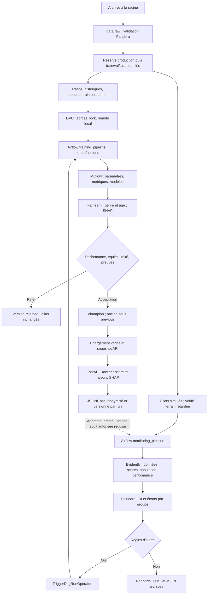

# Architecture et contrats

J'ai séparé la préparation des données, les décisions de promotion et le service d'inférence pour conserver une traçabilité de bout en bout.

## Flux de données et décisions

Le flowchart montre les fonctions disponibles. J'ai déployé le champion Home Credit
version 6. Les lots simulés historiques conservent leur candidat mitigé figé de
diagnostic ; les événements API du champion utilisent son contrat de 264 features. Les DAGs synthétiques `credit_demo`
et `credit_demo_retraining` prouvent la branche acceptation/promotion/rechargement
dans un modèle Registry distinct. Le réentraînement standard ne mélange pas
automatiquement des labels de production au snapshot Kaggle.

## Responsabilités

| Composant | Contrat et rôle |
| --- | --- |
| `src/data/` | Validation, splits alignés, anomalie emploi, audit âge, simulation |
| `src/features/` | Cutoff historique, ratios, encodage train uniquement, colonnes ordonnées |
| `src/models/` | Expériences, seuil métier, Fairlearn, SHAP, gate et alias MLflow |
| `src/monitoring/` | Rapports Evidently, audit Fairlearn, règles, ingestion des événements |
| `src/orchestration/` | Opérations métier et sorties privées par run Airflow |
| `src/serving/` | Chargement des preuves Registry, snapshot atomique, score et journal |
| `src/demo/` | Scénario synthétique isolé réutilisant gate, SHAP, métriques et monitoring |
| `airflow/dags/` | Dépendances, branchement et triggers ; petits XCom de contrôle |
| `api/` | Schémas stricts et endpoints minces |

## Environnements et persistance

Le développement utilise exclusivement `creditS` à la racine. Airflow n'y est
jamais installé. Son image contient le runtime Airflow et un worker ML séparé
dans `/opt/creditS`. L'image API possède ses propres dépendances, un utilisateur
UID 10001 et une racine en lecture seule. La CI utilise `.ci-venv`.

Docker Compose démarre PostgreSQL, MLflow, Airflow webserver/scheduler et FastAPI.
PostgreSQL conserve l'état Airflow ; MLflow utilise SQLite et ses artefacts
persistants. Les ports HTTP sont liés à localhost. Le serveur MLflow local sur
5000 et celui Docker sur 5001 ne partagent pas leurs écritures ; l'initialisation
Docker copie la base locale une seule fois si elle existe.

Les données, modèles et rapports offline sont suivis par DVC. Les checkpoints
Airflow restent dans `runtime/airflow/runs/<hash>`, les démonstrations dans
`runtime/demo/<id>`, les événements API dans un volume. Les bases MLflow/Airflow
et les secrets ne sont pas restaurés par `dvc pull`. `.env`, archives, venv et
sorties privées sont ignorés par Git ; seul le graphique de synthèse publié
dans `docs/assets/` est versionné pour rendre le README lisible sans les données.

## Invariants et comportement d'échec

Toutes les tables X/y/sensitive d'un split gardent des index `SK_ID_CURR` alignés.
J'ai conservé un contrat ordonné de features pour chaque modèle : 261 au développement
initial, puis 264 pour le champion v3. Entraînement, API et monitoring d'une même
version utilisent le même contrat.
La liste exclut TARGET, identifiants, genre, âge et `EMPLOYED_AGE_RATIO`.
Les groupes sensibles restent des données d'audit, accessibles séparément.

Le gate est recalculé avant promotion et compare des données d'évaluation de
même hash. Les preuves SHAP et métriques MLflow sont vérifiées ; une version
rejetée ne remplace jamais un champion. Sans champion accepté, `/health` et
le scoring retournent 503, tandis que `/live` reste 200. Un échec de rechargement
conserve le snapshot précédent ; une erreur de journal empêche de confirmer un
scoring réussi. Les événements HMAC restent des données pseudonymisées.

Les métriques nécessitant la vérité terrain ne sont pas calculées avant sa
disponibilité déclarée. Les comparaisons sans support suffisant sont non évaluables.
Une alerte crée un candidat, pas une autorisation implicite de promotion.
Le gate automatique et SHAP ne remplacent ni une revue humaine ni une validation
indépendante pour un usage de crédit réel.
