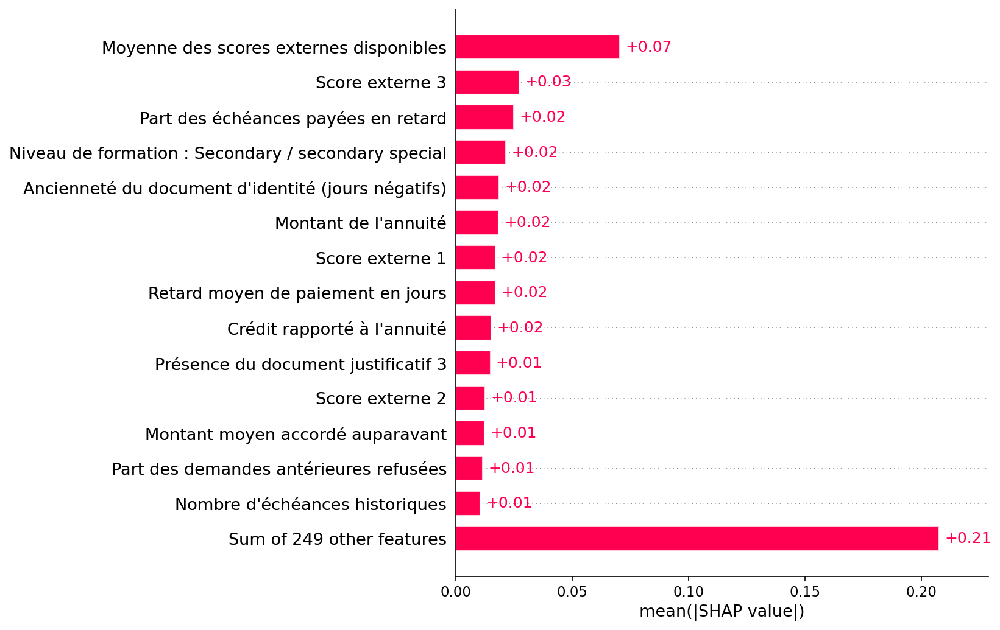

# Ensemble figé : SHAP et plan de qualification

Le 3 octobre 2026, le candidat issu du [développement de capacité](constrained-capacity-development.md)
est empaqueté sans nouvel entraînement ni recherche de seuil. Le test v2 reste
fermé. Le contrôle sur validation et les preuves SHAP passent ; le gate de
promotion échoue explicitement tant que le test indépendant n'est pas évalué.

## Modèle et explications

Le score est la moyenne pondérée des probabilités de **sept classifieurs
LightGBM, chacun de 300 arbres**, avec imputation figée et 263 colonnes ordonnées.
`ProbabilityMixture` conserve les poids positifs et interdit un nouvel ajustement.
Le seuil global reste **0,417** ; 1 signifie défaut prédit/refus et l'acceptation
vaut `1 - prédiction`. Genre, âge et ratio emploi/âge sont réservés à l'audit.
Le score reste non calibré ; il ne constitue pas une PD bancaire validée.

SHAP **0.49.1**, réellement exécuté, explique chaque oracle en espace de
probabilité avec `TreeExplainer`, `feature_perturbation="interventional"` et
un même fond de **50 observations du train uniquement**. Les contributions et
valeurs de base sont combinées avec les poids exacts du score. La somme de la
base et des contributions reconstruit directement ce score, sans transformation
logistique supplémentaire. Cette configuration est conforme à la
[documentation officielle TreeExplainer](https://shap.readthedocs.io/en/latest/generated/shap.TreeExplainer.html).

Sur **400 observations de validation**, l'erreur maximale de reconstruction est
**3,5783342955397757 × 10⁻⁹**, inférieure à la tolérance 10⁻⁶.
Les six artefacts sont présents et vérifiés dans MLflow : summary, bar,
waterfalls accepté/refusé/limite et `shap_report.json`. Les cinq figures ont été
inspectées visuellement. Le fond transformé est conservé dans le modèle pour
que l'explicateur puisse utiliser la même référence après chargement.



| Mesure sur validation | Valeur |
|---|---:|
| AUC | 0,747253 |
| DI âge / genre | 0,809681 / 0,929512 |
| Écart equal opportunity âge / genre | 0,096046 / 0,010897 |
| Recall / acceptation | 0,735516 / 0,585501 |

Les biais sont mesurés et contrôlés selon ces métriques sur validation.
Les marges d'équité sont faibles et la validation a déjà servi à plusieurs
études : ces résultats ne préjugent pas de l'évaluation indépendante.
Les garanties de la politique aléatoire Fairlearn ne s'étendent pas
automatiquement à cette combinaison déterministe.

## Plan figé avant test

Le plan `home-credit-ensemble-evaluation-v1` porte sur un seul candidat après
développement. Il ne modifie pas les six essais du protocole prospectif v2 clos.
Sa configuration conserve les mêmes données, features, paramètres métier et
seuils du quality gate. Les SHA256 figent le candidat, le manifeste parent,
les affectations et cinq modules de qualification/explication.

Le registre de réservation reste **celui du parent v2** :
`runtime/qualification-holdouts/home-credit-independent-v2.json`.
Changer de nom de plan ne permet donc pas de recommencer le test. Ce registre
est absent à la clôture de cette étape ; aucune lecture des fichiers X/y/sensitive
du test n'a eu lieu. Seules les affectations par identifiant sont recopiées.
Une seule évaluation indépendante est autorisée, sans réajustement sur ses
résultats. Un échec conserve le candidat rejeté et ferme ce test à la sélection.

Le modèle empaqueté est loggé dans MLflow, sans enregistrement Registry ni
promotion Home Credit : run `ab7cbd43f1ac4cf58cc7715e1733ab80`, modèle
`models:/m-e8184ab9a9604145a343c9d015a0c770`.
Le candidat a pour SHA256
`710199a7807cdd3ce029f51ac2c4bee7252e509f34e8db5646188c0467b12a1e` ;
les données processed v2 restent `d31d9df8f7826e1ac2309fff126ab0f9.dir`.

[Plan](assets/ensemble-qualification/protocol.json),
[configuration](assets/ensemble-qualification/params.yaml),
[exécution](assets/ensemble-qualification/execution.json),
[gate validation + SHAP](assets/ensemble-qualification/validation_gate.json),
[promotion en attente](assets/ensemble-qualification/promotion_gate_pending.json),
[rapport SHAP](assets/ensemble-qualification/shap_report.json).

## Vérifications exécutées

**144 tests réussis**, 41 avertissements de dépendances, 38,62 secondes.
Ruff et le formatage des 96 fichiers Python passent. Les nouveaux tests couvrent
la sérialisation, la reconstruction SHAP réelle d'un petit ensemble, le refus
de promotion sans test et l'identité du registre parent malgré un nouveau plan.
Le dépôt DVC isolé `runtime/ensemble-qualification` archive le candidat, le plan,
les affectations et les preuves ; **13 fichiers poussés** au remote local commun,
statut propre. Le binaire est exclu de Git.
Le modèle rechargé depuis son URI MLflow reproduit exactement les scores du
bundle sur seize lignes de validation (erreur maximale 0). Le contrôle des hash
du plan réussit, le registre du test reste absent et les alias Home Credit du
Registry local restent vides. Le stage DVC racine `explain` a également été
rejoué et ses artefacts historiques poussés, sans nouvel entraînement.

```powershell
.\creditS\Scripts\Activate.ps1
python -m pytest -q
python -m ruff check .
Get-Content runtime/ensemble-qualification/execution.json
```

La prochaine étape, après validation de l'utilisateur, est l'évaluation unique :

```powershell
.\creditS\Scripts\Activate.ps1
python -m src.models.qualify_holdout --params runtime/ensemble-qualification/params.yaml --candidate runtime/ensemble-qualification/candidate.pkl
```

Cette dernière commande **n'a pas été exécutée à cette étape**. La réussite du
test et du gate complet sera nécessaire avant toute promotion.
