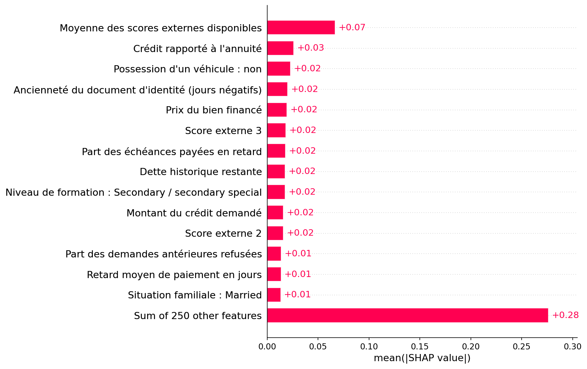

# Candidat v3 : explications et plan d'évaluation figé

J'ai empaqueté le candidat v3 retenu, produit les preuves SHAP et figé son plan d'évaluation avant d'ouvrir le test.

Le candidat de l'[étude de développement à quinze feuilles](v3-refinement-development.md)
est empaqueté sans entraînement ni recherche de seuil supplémentaire. Il contient
neuf classifieurs LightGBM à 500 arbres, l'imputation ajustée sur train et
264 colonnes ordonnées. Le seuil global reste **0,397** ; le score est une
moyenne pondérée déterministe de probabilités d'oracles, sans calibration.
Genre, âge et ratio emploi/âge sont exclus des features et de l'inférence.

## Preuves SHAP exécutées

SHAP 0.49.1 utilise neuf TreeExplainer en espace de probabilité, avec
`feature_perturbation="interventional"` et le même fond de **50 lignes du train**.
Les valeurs de base et contributions sont combinées selon les poids exacts.
La reconstruction est vérifiée sur **400 observations de validation** : erreur
maximale **3,1109694820230516 × 10⁻⁹**, sous la tolérance 10⁻⁶.
Les six artefacts vérifiés dans MLflow sont summary, bar, trois waterfalls
(accepté, refusé et limite) et `shap_report.json`. Les cinq figures ont été
inspectées visuellement. Les exemples fournissent trois raisons avec libellés
explicites ; certaines variables secondaires utilisent un libellé de repli.
Les explications concernent les valeurs imputées et ne sont pas causales.



| Mesure de validation | Valeur |
|---|---:|
| AUC / PR-AUC | 0,751512 / 0,237853 |
| DI âge / genre | 0,852035 / 0,995486 |
| Écart equal opportunity âge / genre | 0,065074 / 0,027496 |
| Recall / taux d'acceptation | 0,787288 / 0,536660 |

Le positif signifie **1 = défaut prédit = refus** ; le DI porte sur l'acceptation
`1 - prédiction`. Les biais sont mesurés et contrôlés selon ces métriques sur
la validation réutilisée. SHAP ne prouve pas l'équité. Le DI âge est proche de
la marge de développement, et les garanties de la politique randomisée
Fairlearn ne se transfèrent pas automatiquement au score déterministe audité.

## Plan et frontière de qualification

Le plan `home-credit-ensemble-evaluation-v3` porte sur **un seul candidat figé**
après développement, sans modifier la campagne prospective v3 initiale close.
Il indique explicitement que la validation a été réutilisée. Les SHA256 figent
le candidat, le manifeste parent, les affectations et cinq modules de qualification
et d'explication. Les données processed restent
`fdec4513d9be07de9abdfe5a2d89130c.dir`.
Les données, règles métier et seuils de production du parent restent inchangés.

Le registre partagé reste celui du parent :
`runtime/qualification-holdouts/home-credit-independent-v3.json`.
Il est **absent à la clôture de cette préparation**. Le test v3 n'est pas lu
ni évalué ; seules ses affectations par identifiant sont recopiées.
Une seule évaluation est autorisée, sans réajustement sur ses résultats.
Un échec ferme ce test à la sélection. Le registre v2 déjà évalué demeure intact.

Le contrôle **validation + preuves SHAP passe**. Le gate complet de promotion
**échoue explicitement pour test indépendant non évalué**. Aucun Registry
Home Credit ni alias champion n'est créé par cette préparation.
Run de packaging : `be0bd59daa9c4b1ba83a23798b016a86`, modèle MLflow
`models:/m-7f7e8dd48ed44f829c98e924da084e4f`.
L'instantané empaqueté fait **8 298 695 octets**, SHA256
`fa44ff4fe614630456f5980301b852535e488a4dfb1bd079ecab0df7c2244ecd`.
Le rechargement depuis MLflow reproduit exactement les scores sur seize lignes
de validation, erreur maximale 0 ; le contrat et les empreintes sont vérifiés.

[Plan figé](assets/v3-ensemble-qualification/protocol.json),
[configuration](assets/v3-ensemble-qualification/params.yaml),
[exécution](assets/v3-ensemble-qualification/execution.json),
[contrôle indépendant des preuves](assets/v3-ensemble-qualification/verification.json),
[gate validation + SHAP](assets/v3-ensemble-qualification/validation_gate.json),
[promotion bloquée](assets/v3-ensemble-qualification/promotion_gate_pending.json),
[rapport SHAP](assets/v3-ensemble-qualification/shap_report.json).

## Correction et vérifications

La première préparation a produit le modèle et SHAP, puis a arrêté le gel :
le contrôle préparatoire réappliquait l'exigence de test du parent v3.
La correction distingue un screening validation + SHAP d'une autorisation
de promotion. Elle ne modifie ni la configuration figée du parent ni le gate
complet. Une reprise de finalisation recharge le candidat existant, vérifie
ses scores sur toute la validation, son fond train et son run `FINISHED`.
Aucun fit ni calcul SHAP n'est recommencé, et aucun test n'est ouvert.
Un test de régression vérifie cette séparation et le maintien du blocage de
promotion ; les autres tests refusent une sélection modifiée ou un test déjà utilisé.

Les artefacts, le candidat et les affectations sont archivés dans le dépôt DVC
isolé `runtime/v3-ensemble-qualification`, au remote local commun ; les binaires
restent exclus de Git. **Quinze objets supplémentaires ont été poussés** au
remote local commun ; le statut du dépôt isolé est propre. Les empreintes de
qualification v2 restent inchangées.

Validation exécutée après correction : **158 tests réussis en 32,14 secondes**,
41 avertissements de dépendances ; Ruff et formatage des 98 fichiers conformes.

```powershell
.\creditS\Scripts\Activate.ps1
Get-Content runtime/v3-ensemble-qualification/execution.json
Get-Content runtime/v3-ensemble-qualification/promotion_gate_pending.json
python -m pytest -q
python -m ruff check .
```

J'ai réservé l'évaluation indépendante unique du test v3 à l'étape suivant le gel
du plan. Le test n'a pas été ouvert pendant cette préparation.

## Évaluation et déploiement ultérieurs

Après le gel du plan, l'évaluation indépendante unique passe : AUC
0,752030, DI âge 0,886048, EO âge 0,061134. Le candidat est promu champion 6,
puis transféré au Registry Docker et rechargé dans l'API. Les constats de test
intact et de promotion bloquée ci-dessus décrivent la préparation historique ;
le plan et ses preuves ne sont pas réécrits après connaissance du résultat.
[Bilan définitif](project-completion.md).
